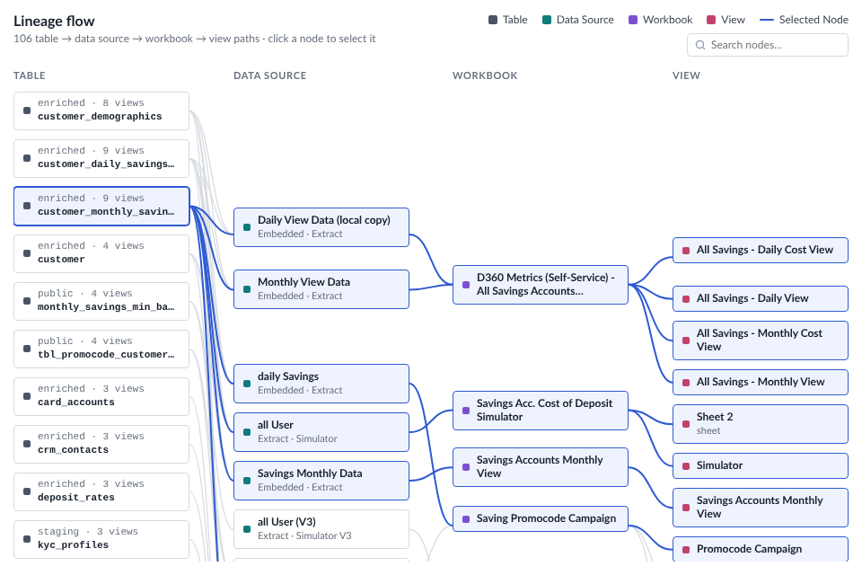

# Data Lineage — Tableau Viz Extension

A lineage flow: every row of the worksheet is one path, such as *table → data source → workbook → view*. Each
dimension on **Levels** becomes a column of nodes, linked to the next column with curved lines. Click a node and every
path through it turns blue, and its value is selected in Tableau for dashboard actions. The icon, title and explanation
are the same as **KPI Card**; the card options and presets are the same as **Bar Chart**.



```
data-lineage.trex  manifest: Marks card tiles + "Format Extension" button
index.html         chart page
chart.css/js       header, legend, search, data reading, layout, links, highlight, tooltip, right-click menu
configure.*        Format dialog (every option below)
config.js          shared defaults, settings read / write, colours
icons.js, icons/   the Figma icons from *Icons for Extension* (same files as KPI Card)
fonts/             Lato 2.0 (OFL), WOFF2 Latin subset
serve.py/.sh       local server on :8771
presets/           sample presets (Default, Compact elbow)
dev/               browser preview with sample data (no Tableau needed)
```

`SCR-*.png` (design references) stay out of git.

## Run it

```bash
chmod +x serve.sh && ./serve.sh
```

In Tableau Desktop (2024.2+): Marks card → mark type dropdown → **Add Extension** → **Access Local Extensions** →
`Data Lineage localhost.trex` (in the `tableau-extensions` folder; it points at `http://localhost:8771`).

To try it without Tableau, open <http://localhost:8771/dev/preview.html>. It has five sample data sets (the design's
table › data source › workbook › view, a 3-level system › model › report, empty values, a stress test and a single
level) and opens the Format dialog next to the chart.

| Marks card tile | What to drop | Drives |
| --- | --- | --- |
| **Levels** | 1–6 dimensions, **one at a time**, source first (e.g. Table, Data Source, Workbook, View) | one column per field, in tile order. Each row links its values from column to column |
| **Details** | up to 8 dimensions (optional), e.g. Schema, Connection type, Sheet type | node subtitles. Each one goes under the level it describes |
| **Tooltip** / **Detail** (Tableau's) | any fields (optional) | extra tooltip rows |

- Nodes are matched **by name within a column**. If two items share a name (two data sources called *all User*), give
  them a unique label, e.g. a calculated field with the name and the workbook or id.
- **Empty values**: by default the path skips that level and the link jumps over the column (a table nobody uses is a
  node with no links). Levels & details → *Empty values* can show a “Null” node instead.
- **Details find their level**: a detail goes under the first level where every node has a single value of it
  (Schema → Table, Connection → Data Source, Sheet type → View). Pick another level, or show it after the name, in the
  tooltip only, or not at all, in Levels & details.
- **Counts**: “enriched · 9 views” on the first column is the number of last-level items each node feeds. Turn it on
  for any level; the word comes from the last level's name or *Count word*.

## In the chart

- **Hover** a node: tooltip with its level, details, how many upstream and downstream items it has per level, and the
  number of paths. While nothing is selected, its lineage is previewed.
- **Click** a node: every path through it is highlighted (blue links, light blue nodes) and the value is selected in
  Tableau. Click it again, on empty space, or press Esc to clear.
- **Search** (top right): finds nodes by name in any column, outlines them and highlights their lineage (or shows only
  their lineage). Enter scrolls to the first match; Esc clears.
- **Double-click** a node: opens Format → Levels & details on its level.
- **Right-click**: select lineage, search for this node, format its level, and quick links to the Format tabs.
- Too many nodes for the space: the chart scrolls, with the column headers kept on top. Columns narrower than the
  minimum node width scroll sideways.

## Format dialog

**Format Extension** at the bottom of the Marks card, or right-click the chart. The chart updates as you change things.
**Cancel** undoes everything since the dialog opened; **Reset tab** restores that tab's defaults.

| Tab | Options |
| --- | --- |
| Icon | as KPI Card: built-in icons or **upload** (off by default) |
| Title & text | show, text, alignment, font, size, weight, colour; explanation with *Keep space when empty*. `{paths}`, `{nodes}` and `{flow}` (the levels joined by →) show this chart's numbers; `<Parameter name>` a parameter's value |
| Levels & details | per level: column header, legend name, colour, monospace names, subtitle above or below, count · per detail: level (auto or fixed) and show as subtitle / after name / tooltip only / hidden · order in columns (fewest crossings, most paths, name) · empty values · count word |
| Nodes | placement (next to linked nodes, or from the top) · min / max width · spacing and padding · name lines · background, border, radius · level marker · name and subtitle fonts |
| Links & highlight | curved, elbow or straight links · colour, width, opacity, space between columns · selected lineage: link colour and width, node background and border, bold names, keep / fade / hide the rest, hover preview, search outline |
| Headers & legend | column headers (font, uppercase, letter spacing) · legend: next to the title, above or below the chart, field names or headers, “Selected Node” item |
| Search & actions | search box (placeholder, highlight or filter, width) · tooltip parts · select in Tableau · right-click menu · double-click · Format window on top of Tableau or floating |
| Card | padding, space above the chart, background and chart-area background |
| Presets | export, import and save settings |

## Settings and deploying

Everything is stored in the workbook under one settings key (`dataLineage1`). Level colours and styles are stored by
position; column headers, legend names and detail placement by field name, so renaming a pill starts those from the
defaults. Renamed pills are still matched to their data columns by position.

1. The Tableau Extensions API library is bundled in `lib/tableau.extensions.1.17.0.min.js` (no CDN).
2. Run `python3 stamp-versions.py` before every commit (cache-busting for GitHub Pages).
3. Host the folder over HTTPS (GitHub Pages: `Cobani/data_lineage_extension`) and check `<source-location><url>` in
   `data-lineage.trex`.
4. Add the URL to the Tableau Server extension safe list. `dev/` doesn't need to be deployed.

Tableau reads the `.trex` only when the extension is added, so after editing it, remove the extension and add it again.

### Presets

Presets (Format → Presets) store only the settings that differ from the defaults, with a format `version` (now 1).
When the extension changes:

- a new option needs nothing: presets without it get its default;
- a setting tied to the sheet's fields goes into `FIELD_PATHS` (left out of *Look only* presets);
- a renamed or moved setting bumps `PRESET_VERSION` and gets a step in `PRESET_MIGRATIONS` (`configure.js`), and the
  files in `presets/` are re-saved in the new version.

### Fast reload (last-render cache)

After each successful render the extension saves its data in the browser (localStorage, per Tableau Server and
worksheet). On the next load it draws that right after the Tableau handshake, then replaces it with the live data. If
the fields on the Marks card changed, the saved drawing is removed as soon as Tableau reports the fields. Saved results
older than 30 days are ignored.

### Performance

- Hover and click only restyle nodes and redraw the highlighted links; the layout runs only when data, size or
  settings change.
- `dev/preview.html` → *Stress test* (`index.html?mock&data=big&n=400` ≈ 1,100 nodes, 1,900 links): a full layout
  takes about 0.1 s.

### Load timings (debug)

In DevTools, pick this extension's frame in the Console, run `localStorage.setItem('extDebug', '1')` and reload. Each
load prints a table of steps and files. `extTimings()` prints it on demand; `localStorage.removeItem('extDebug')`
turns it off. In the dev preview, add `?debug` to the URL.
